E, levando-se em conta a posição da viga na estrutura, dada pelo ângulo  $\alpha$  e contabilizada pelos valores do seno e cosseno desse ângulo. Como temos mais de um componente de deslocamento presente por nó, vamos utilizar a linguagem já introduzida dos Graus de Liberdade do Elemento. Dessa forma o Vetor de Localização continuará posicionando o elemento do nó 1 para o nó 2, porém destacando a contribuição de cada grau de liberdade na montagem da matriz. A identificação dos Graus de Liberdade do Elemento no Vetor de Localização segue uma ordem dentro do nó: primeiro é identificado o Grau de liberdade em X, e posteriormente em Y. Então, para o elemento da figura 3.6, teremos:

![Diagram of a 4x4 stiffness matrix [K] with degrees of freedom X and Y. The matrix is partitioned into two blocks, N01 and N02. N01 contains the top 2x2 submatrix with degrees of freedom X and Y. N02 contains the bottom 2x2 submatrix. The global stiffness matrix is defined as [K]e = A.E/L.](c397c8d13a885b05543b490ca9317118_img.jpg)

Diagram showing a 4x4 stiffness matrix  $[K]_e = \frac{A.E}{L}$ . The matrix is partitioned into two blocks,  $N_{01}$  and  $N_{02}$ .  $N_{01}$  is the top 2x2 submatrix with degrees of freedom  $X$  and  $Y$ .  $N_{02}$  is the bottom 2x2 submatrix. The global stiffness matrix is defined as  $[K]_e = \frac{A.E}{L}$ .

|               | $U_1$         | $V_1$         | $U_2$         | $V_2$ |  |
|---------------|---------------|---------------|---------------|-------|--|
| $\lambda^2$   | $\lambda\mu$  | $-\lambda^2$  | $-\lambda\mu$ |       |  |
| $\lambda\mu$  | $\mu^2$       | $-\lambda\mu$ | $-\mu^2$      |       |  |
| $-\lambda^2$  | $-\lambda\mu$ | $\lambda^2$   | $\lambda\mu$  |       |  |
| $-\lambda\mu$ | $-\mu^2$      | $\lambda\mu$  | $\mu^2$       |       |  |

Degrees of freedom:  $X$  (Grau de Liberdade),  $Y$  (Grau de Liberdade).

Global stiffness matrix:  $[K]_e = \frac{A.E}{L}$ .

Diagram of a 4x4 stiffness matrix [K] with degrees of freedom X and Y. The matrix is partitioned into two blocks, N01 and N02. N01 contains the top 2x2 submatrix with degrees of freedom X and Y. N02 contains the bottom 2x2 submatrix. The global stiffness matrix is defined as [K]e = A.E/L.

(3.9)

A aplicação numérica e a identificação da Numeração dos Graus de Liberdade dos Elementos em uma montagem com elementos de treliça serão feitas adiante por intermédio de um exercício. Ao efetuarmos a montagem de uma estrutura constituída por elementos de mola, os vetores de localização foram referidos à numeração dos nós no âmbito da estrutura inteira. Para a treliça, o mesmo ocorrerá com a identificação da numeração dos graus de liberdade para a estrutura inteira.

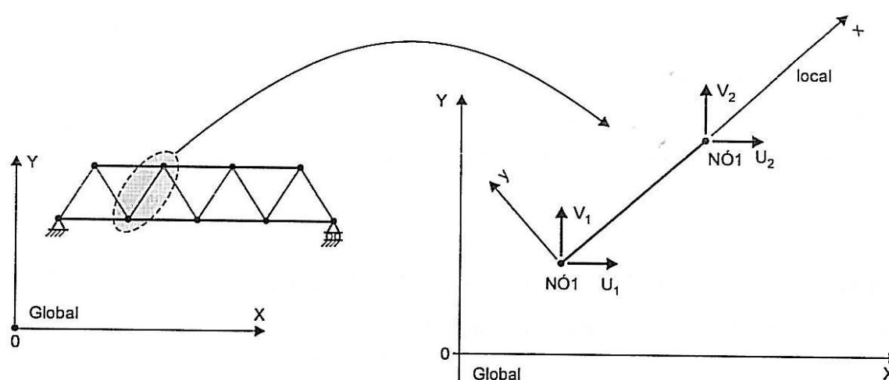

The diagram illustrates the relationship between global and local coordinate systems for a truss structure. On the left, a truss is shown with a global coordinate system (X, Y) originating from 0. A dashed ellipse highlights a specific node on the truss. A curved arrow points from this node to a local coordinate system on the right. The local system has axes labeled  $U_1$ ,  $U_2$ ,  $V_1$ , and  $V_2$ , with a node labeled NÓ1. The local axes are also labeled 'local' and 'Y'. The global axes are labeled 'Global' and 'X'.

Global

X

0

Y

local

$U_2$

$V_2$

NÓ1

$U_1$

$V_1$

NÓ1

Y

0

Global

X

Engineering drawing: Global and local coordinate systems for a truss structure.

Figura 3.6 – Elemento de Barra de Treliça, considerando os Componentes de Deslocamentos no Sistema Global.

## 3.4. EXERCÍCIO DE APLICAÇÃO PARA ESTRUTURA NA FORMA DE TRELIÇA

Neste caso de Aplicação será resolvido um Modelo Estrutural constituído por uma *montagem de Elementos de Barra de Treliça Plana*, como indica a figura 3.7. Embora seja uma Estrutura Simples, aproveitaremos este exemplo para desenvolver a montagem de um modelo estrutural, considerando de forma geral o *conceito de Graus de Liberdade*. Iremos desenvolvê-lo de modo sistemático, aplicando numericamente todas as etapas tratadas anteriormente, e a partir deste exemplo poderemos estabelecer algumas generalizações importantes para as aplicações práticas de elementos finitos utilizadas no dia-a-dia com a utilização dos “softwares” de Análise, ampliando as idéias desenvolvidas a partir do elemento de mola.

São conhecidas as Forças atuantes na Estrutura e representadas na figura 3.7. Objetiva-se Calcular os Deslocamentos Nodais, em seguida as Reações nos vínculos ou Apoios da Estrutura, e finalmente as Forças Internas em cada um dos Elementos.

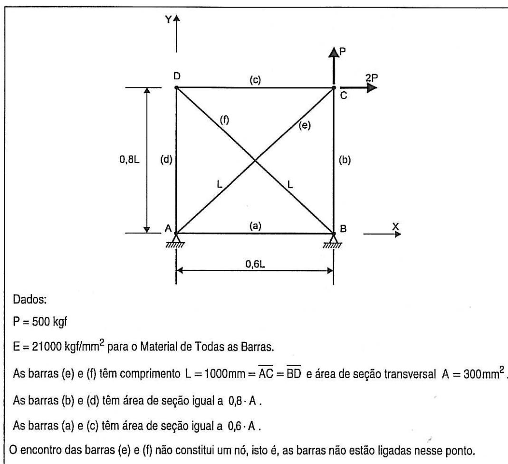

The diagram shows a square truss with vertices A, B, C, and D. The horizontal base AB is supported by a pin at A and a roller at B. A vertical load P is applied at vertex C, and a horizontal load 2P is applied to the right of vertex C. The vertical dimension from A to D is 0,8L, and the horizontal dimension from A to B is 0,6L. The diagonal members are labeled (e) and (f). The horizontal members are labeled (a) and (c). The vertical member is labeled (b). The diagonal members are both labeled L. A coordinate system with Y pointing up and X pointing right is shown.

Dados:

$P = 500 \text{ kgf}$

$E = 21000 \text{ kgf/mm}^2$  para o Material de Todas as Barras.

As barras (e) e (f) têm comprimento  $L = 1000\text{mm} = \overline{AC} = \overline{BD}$  e área de seção transversal  $A = 300\text{mm}^2$ .

As barras (b) e (d) têm área de seção igual a  $0,8 \cdot A$ .

As barras (a) e (c) têm área de seção igual a  $0,6 \cdot A$ .

O encontro das barras (e) e (f) não constitui um nó, isto é, as barras não estão ligadas nesse ponto.

Engineering drawing: Truss structure with applied loads and dimensions.

Figura 3.7 – Estrutura constituída por Barras de Treliça para Cálculo pelo Método dos Elementos Finitos.

### 3.4.1. DEFINIÇÃO DO MODELO ESTRUTURAL COMO UMA MONTAGEM DE ELEMENTOS

Deve-se *dividir a Estrutura Real em uma Montagem de Elementos*, que sejam adequados para simular o problema físico objeto de investigação. No modelo são identificados os Nós, entre os quais os elementos são definidos, isto é, entre os quais os elementos *“trabalham”*.

Neste exemplo, o Modelo da Estrutura Reticulada surge naturalmente e corresponde à própria figura 3.7.

### 3.4.2. DETERMINE A MATRIZ DE RIGIDEZ DE CADA ELEMENTO E REPRESENTE-A NO SISTEMA GLOBAL

Vimos anteriormente que o elemento de treliça é definido por dois nós, e no âmbito isoiado do elemento associamos uma numeração interna a ele, que são os nós 1 e 2. A partir da formulação de um elemento finito, ele estará disponível na *“Biblioteca de Elementos”* por intermédio de sua Matriz de Rigidez. Assim, qualquer que seja o elemento de treliça, e independentemente de onde for ser utilizado, a sua Matriz de Rigidez é dada por:

$$[k]^e = \begin{bmatrix} \frac{A.E}{L} & -\frac{A.E}{L} \\ -\frac{A.E}{L} & \frac{A.E}{L} \end{bmatrix}$$

Ao representar a montagem de elementos no modelo, cada elemento deverá referir-se ao Sistema que vale para a estrutura como um todo, isto é, o **Sistema Global de Coordenadas**, para posteriormente montar-se a Matriz de Rigidez da Estrutura a partir das Matrizes de Rigidez de cada um de seus elementos. A expressão da Matriz de Rigidez de cada elemento no Sistema Global é dada por (3.9). É fundamental, ao definir os Vetores de Localização de cada elemento, **estabelecer os seus Nós 1 e 2, pois estes definirão a orientação do eixo local x do elemento**. Essa definição é arbitrária, porém escolhidos esses nós, esta orientação deverá permanecer inalterada, pois **definirá o ângulo  $\alpha$  formado entre os eixos x local e X global**.

Outro aspecto fundamental refere-se aos vetores de localização. Estes devem, em um procedimento automatizado, referir-se à numeração em coordenadas da estrutura. Como cada nó tem mais que um grau de liberdade, **os graus de liberdade são identificados por intermédio de uma numeração**, seguindo uma orientação padronizada. Por exemplo, os Graus de Liberdade são numerados **“dentro”** de cada nó, seguindo uma seqüência inalterada. Assim, **numera-se o Grau de Liberdade X de um nó e depois o grau de liberdade Y, e assim sucessivamente em todos os nós**.

Vale observar que, na prática, os Programas de Análise por Elementos Finitos seguem internamente esse mesmo procedimento para “administrar” o sistema de equações, como veremos adiante. O usuário normalmente identifica um número de nó, mas **“escondida”** atrás dessa numeração está definida a **numeração interna dos graus de liberdade**. Neste exemplo, estamos fazendo o papel do **“software”** de análise, com o objetivo de entender os procedimentos do método, portanto adotaremos essa nomenclatura. Para que não haja confusão entre número de nó, e número de grau de liberdade, os nós foram identificados por intermédio de letras, apenas por motivo didático.

Assim, na figura 3.8, foram feitas as numerações dos graus de liberdade da estrutura, seguindo a orientação estabelecida, independentemente de qualquer condição de restrição.

Nessa mesma figura foi identificada para cada elemento a definição do **eixo local x**, por intermédio da escolha arbitrária dos nós 1 e 2. A partir dessa definição, cada elemento foi identificado em uma visão **“explodida”**, de modo a definir em cada caso o valor do ângulo  $\alpha$ . Assim, para a estrutura em estudo, temos:

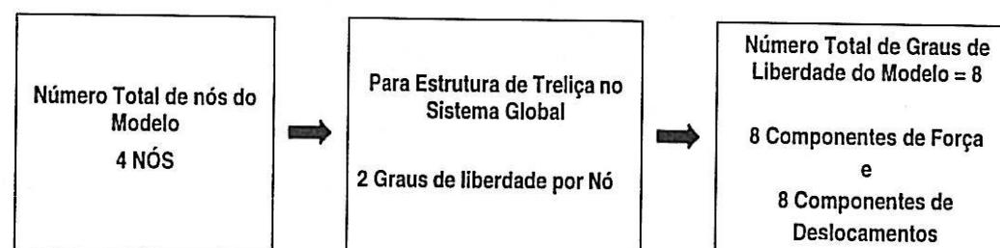

The diagram consists of three rectangular boxes connected by right-pointing arrows. The first box contains the text 'Número Total de nós do Modelo' and '4 NÓS'. The second box contains 'Para Estrutura de Treliça no Sistema Global' and '2 Graus de liberdade por Nó'. The third box contains 'Número Total de Graus de Liberdade do Modelo = 8' and '8 Componentes de Força e 8 Componentes de Deslocamentos'.

```
graph LR; A["Número Total de nós do Modelo<br/>4 NÓS"] --> B["Para Estrutura de Treliça no Sistema Global<br/>2 Graus de liberdade por Nó"]; B --> C["Número Total de Graus de Liberdade do Modelo = 8<br/>8 Componentes de Força e 8 Componentes de Deslocamentos"]
```

Número Total de nós do Modelo  
4 NÓS

Para Estrutura de Treliça no Sistema Global  
2 Graus de liberdade por Nó

Número Total de Graus de Liberdade do Modelo = 8  
8 Componentes de Força e  
8 Componentes de Deslocamentos

Flowchart: Flowchart showing calculation of total degrees of freedom in a global structural system.

Assim, as Matrizes que contêm as Forças Nodais de toda a Estrutura e os Deslocamentos Nodais serão:

$$\{F\} = \begin{Bmatrix} F_1 \\ F_2 \\ F_3 \\ F_4 \\ F_5 \\ F_6 \\ F_7 \\ F_8 \end{Bmatrix} \quad \text{e} \quad \{\Delta\} = \begin{Bmatrix} \Delta_1 \\ \Delta_2 \\ \Delta_3 \\ \Delta_4 \\ \Delta_5 \\ \Delta_6 \\ \Delta_7 \\ \Delta_8 \end{Bmatrix}$$

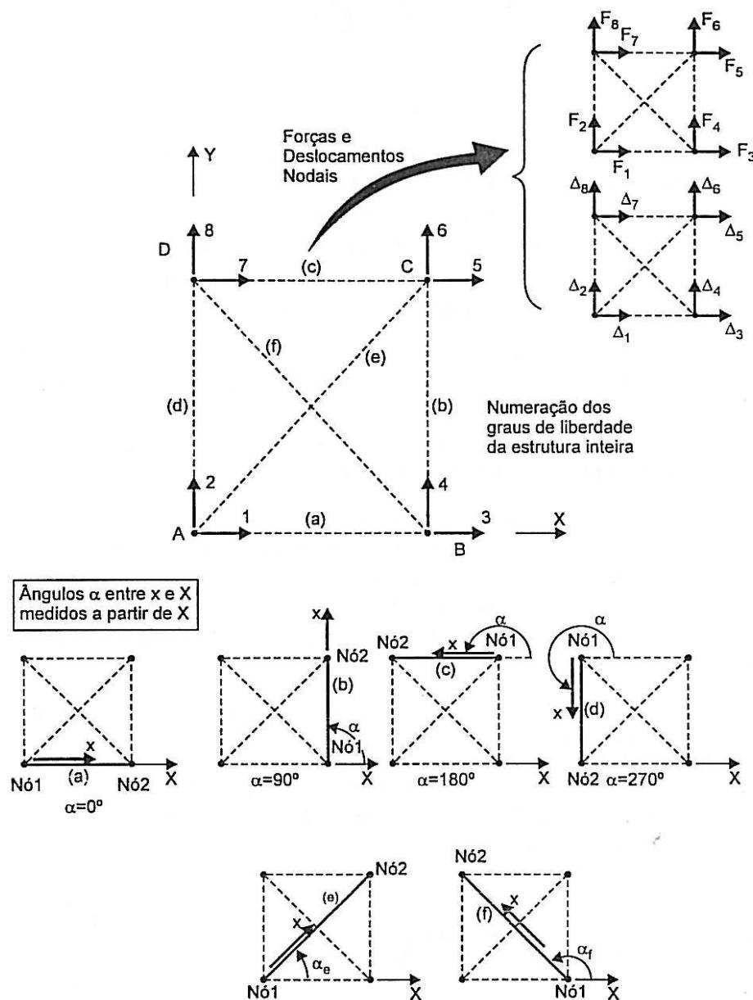

The diagram illustrates the analysis of a square frame structure. The frame has nodes A, B, C, and D, and members (a) through (f). The Y-axis is at node D, and the X-axis is at node B.

**Forças e Deslocamentos Nodais**: An arrow points from the frame to a detailed view of the nodal forces and displacements. The forces are labeled  $F_1$  through  $F_8$ , and the displacements are labeled  $\Delta_1$  through  $\Delta_8$ .

**Numeração dos graus de liberdade da estrutura inteira**: The diagram shows the global degrees of freedom for the entire structure, with nodes 1 through 8 and members (a) through (f).

**Ângulos  $\alpha$  entre x e X medidos a partir de X**: Four diagrams show the angle  $\alpha$  between the global X-axis and a local x-axis for different member orientations:

- (a)  $\alpha=0^\circ$ : Horizontal member.
- (b)  $\alpha=90^\circ$ : Vertical member.
- (c)  $\alpha=180^\circ$ : Horizontal member pointing left.
- (d)  $\alpha=270^\circ$ : Vertical member pointing down.

Two additional diagrams show the angle  $\alpha_e$  for member (e) and the angle  $\alpha_f$  for member (f):

- (e)  $\alpha_e$ : Member (e) is oriented at an angle  $\alpha_e$  from the horizontal.
- (f)  $\alpha_f$ : Member (f) is oriented at an angle  $\alpha_f$  from the horizontal.

Engineering drawing: Structural frame analysis showing nodal forces, degrees of freedom, and angle definitions.

Figura 3.8 – Além de representar cada nó do Modelo da Estrutura, para cada nó da estrutura inteira é representada a numeração dos Graus de Liberdade.

A figura 3.9 representa cada elemento do modelo identificando os graus de liberdade associados aos nós 1 e 2 do elemento.

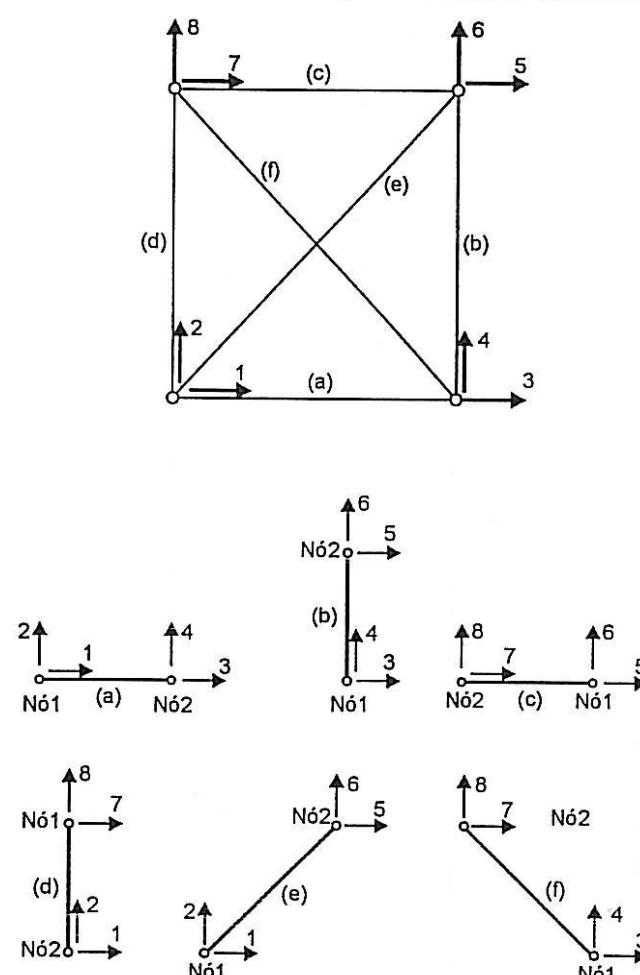

The diagram shows a truss structure with six nodes and seven members. The global coordinate system is shown at the top, with nodes labeled (a) through (f). The members are labeled (a) through (f). Below the structure, six individual member diagrams are shown, each with its own local coordinate system and node labels (Nó1, Nó2).

Global Structure:

- Nodes: (a), (b), (c), (d), (e), (f)
- Members: (a), (b), (c), (d), (e), (f)
- Coordinates: (a) has  $x=1, y=2$ ; (b) has  $x=4, y=4$ ; (c) has  $x=5, y=6$ ; (d) has  $x=0, y=8$ ; (e) has  $x=4, y=0$ ; (f) has  $x=0, y=0$ .

Member (a): Nodes Nó1, Nó2. Local axes:  $x=1, y=2$ .

Member (b): Nodes Nó1, Nó2. Local axes:  $x=3, y=4$ .

Member (c): Nodes Nó2, Nó1. Local axes:  $x=5, y=6$ .

Member (d): Nodes Nó1, Nó2. Local axes:  $x=1, y=2$ .

Member (e): Nodes Nó1, Nó2. Local axes:  $x=1, y=2$ .

Member (f): Nodes Nó2, Nó1. Local axes:  $x=4, y=4$ .

Engineering drawing: Truss structure with global and local coordinate systems and member labels.

Figura 3.9 – Identificação de cada elemento do modelo e os correspondentes graus de liberdade, numerados ao longo da estrutura inteira.

A partir da figura anterior, utilizando a expressão da Matriz de Rigidez de um Elemento de Barra Articulada, vamos montar a Matriz de Rigidez de cada um dos elementos da estrutura. Na tabela seguinte são identificados todos os valores necessários para efetuar essa montagem e, em seguida, a expressão geral da matriz de rigidez de um elemento de treliça no sistema Global.

Tabela 3.1 – Ângulos  $\alpha$  para as diversas barras do modelo da estrutura.

| ELEMENTO | $\alpha$        | $\lambda$ | $\mu$ | $\lambda^2$ | $\mu^2$ | $\lambda . \mu$ |
|----------|-----------------|-----------|-------|-------------|---------|-----------------|
| <b>a</b> | 0<sup>0</sup>   | 1         | 0     | 1           | 0       | 0               |
| <b>b</b> | 90<sup>0</sup>  | 0         | 1     | 0           | 1       | 0               |
| <b>c</b> | 180<sup>0</sup> | -1        | 0     | 1           | 0       | 0               |
| <b>d</b> | 270<sup>0</sup> | 0         | -1    | 0           | 1       | 0               |
| <b>e</b> | $\alpha_e$      | 0,6       | 0,8   | 0,36        | 0,64    | 0,48            |
| <b>f</b> | $\alpha_f$      | -0,6      | 0,8   | 0,36        | 0,64    | -0,48           |

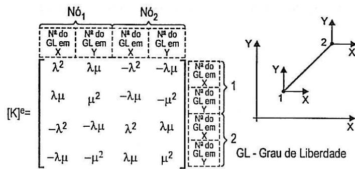

The diagram illustrates the degrees of freedom (GL) for a beam element. On the left, a 4x4 matrix  $[K]^e =$  is shown with two columns labeled  $N\acute{o}_1$  and  $N\acute{o}_2$ . The rows are labeled  $N^\circ$  do GL em X and Y. The matrix elements are:  $\lambda^2, \lambda\mu, -\lambda^2, -\lambda\mu$ ;  $\lambda\mu, \mu^2, -\lambda\mu, -\mu^2$ ;  $-\lambda^2, -\lambda\mu, \lambda^2, \lambda\mu$ ;  $-\lambda\mu, -\mu^2, \lambda\mu, \mu^2$ . To the right of the matrix is a vertical stack of dashed boxes labeled 'Nº do GL em X' and 'Nº do GL em Y', with numbers 1 and 2 indicating the number of degrees of freedom for each node. On the right, a 2D coordinate system shows a beam element with nodes 1 and 2, with axes X and Y.

$[K]^e =$

|                      | $N\acute{o}_1$ | $N\acute{o}_2$ |
|----------------------|----------------|----------------|
| $N^\circ$ do GL em X | $\lambda^2$    | $\lambda\mu$   |
| $N^\circ$ do GL em Y | $\lambda\mu$   | $\mu^2$        |
| $N^\circ$ do GL em X | $-\lambda^2$   | $-\lambda\mu$  |
| $N^\circ$ do GL em Y | $-\lambda\mu$  | $\mu^2$        |

1

2

GL - Grau de Liberdade

Technical illustration: Matrix of degrees of freedom for a beam element and its coordinate system.

Assim, substituindo os valores numéricos definidos na tabela anterior, teremos as Matrizes de Rigidez de todos elementos da estrutura objeto de análise, dadas em seguida.

$$[K]^a = \frac{(0,6A).E}{0,6.L} \begin{bmatrix} 1 & 2 & 3 & 4 \\ 1 & 0 & -1 & 0 \\ 0 & 0 & 0 & 0 \\ -1 & 0 & 1 & 0 \\ 0 & 0 & 0 & 0 \end{bmatrix} \begin{array}{l} 1 \\ 2 \\ 3 \\ 4 \end{array}$$


Diagram (a) shows a line segment between nodes N01 and N02. Node N01 has a vertical arrow pointing up labeled 2, and a horizontal arrow pointing right labeled 1. Node N02 has a vertical arrow pointing up labeled 4, and a horizontal arrow pointing right labeled 3. The segment is labeled (a).

Diagram (a) showing a line segment between nodes N01 and N02. Node N01 has a vertical arrow pointing up labeled 2, and a horizontal arrow pointing right labeled 1. Node N02 has a vertical arrow pointing up labeled 4, and a horizontal arrow pointing right labeled 3. The segment is labeled (a).

$$[K]^b = \frac{(0,8A).E}{0,8.L} \begin{bmatrix} 3 & 4 & 5 & 6 \\ 0 & 0 & 0 & 0 \\ 0 & 1 & 0 & -1 \\ 0 & 0 & 0 & 0 \\ 0 & -1 & 0 & 1 \end{bmatrix} \begin{array}{l} 3 \\ 4 \\ 5 \\ 6 \end{array}$$

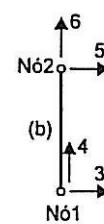

(b)

```
graph TD; N01((Nó1)) -->|6| N02((Nó2)); N01 -->|4| N02; N01 -->|3| E1[ ]; N02 -->|5| E2[ ];
```

A directed graph showing two nodes, N01 and N02. Node N01 has three outgoing edges: one to N02 labeled 4, one to N02 labeled 6, and one to the right labeled 3. Node N02 has one outgoing edge to the right labeled 5.

Network diagram: Directed graph with two nodes and numbered edges.

$$[K]^c = \frac{(0,6A).E}{0,6.L} \begin{bmatrix} 5 & 6 & 7 & 8 \\ 1 & 0 & -1 & 0 \\ 0 & 0 & 0 & 0 \\ -1 & 0 & 1 & 0 \\ 0 & 0 & 0 & 0 \end{bmatrix} \begin{array}{l} 5 \\ 6 \\ 7 \\ 8 \end{array}$$

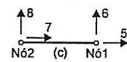

A horizontal beam connects two nodes, labeled N02 and N01. Node N02 is on the left and N01 is on the right. Above the beam, there are three arrows: a vertical arrow pointing up from N02 labeled 8, a horizontal arrow pointing right from N02 labeled 7, and a vertical arrow pointing up from N01 labeled 6. To the right of N01, there is a horizontal arrow pointing right labeled 5. The label (c) is placed below the beam.

Engineering drawing: Structural frame with numbered nodes and directional arrows.

$$[K]^d = \frac{(0,8A)E}{0,8.L} \begin{bmatrix} 7 & 8 & 1 & 2 \\ 0 & 0 & 0 & 0 \\ 0 & 1 & 0 & -1 \\ 0 & 0 & 0 & 0 \\ 0 & -1 & 0 & 1 \end{bmatrix} \begin{array}{l} 7 \\ 8 \\ 1 \\ 2 \end{array}$$

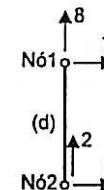

(d)

8

N01

2

N02

Diagram (d) showing a vertical line segment between nodes N01 and N02. An arrow points upwards from N02 to N01, labeled '2'. An arrow points upwards from N01, labeled '8'.

$$[K]^e = \frac{AE}{L} \begin{bmatrix} 1 & 2 & 5 & 6 \\ 0,36 & 0,48 & -0,36 & -0,48 \\ 0,48 & 0,64 & -0,48 & -0,64 \\ -0,36 & -0,48 & 0,36 & 0,48 \\ -0,48 & -0,64 & 0,48 & 0,64 \end{bmatrix} \begin{array}{l} 1 \\ 2 \\ 5 \\ 6 \end{array}$$

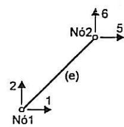

Diagram (e) shows two nodes, Nó1 and Nó2, connected by a line segment. Node Nó1 has a horizontal axis labeled 1 and a vertical axis labeled 2. Node Nó2 has a horizontal axis labeled 5 and a vertical axis labeled 6.

Engineering drawing: Two connected nodes with coordinate axes and numerical labels.

$$[K]^f = \frac{AE}{L} \begin{bmatrix} 3 & 4 & 7 & 8 \\ 0,36 & -0,48 & -0,36 & 0,48 \\ -0,48 & 0,64 & 0,48 & -0,64 \\ -0,36 & 0,48 & 0,36 & -0,48 \\ 0,48 & -0,64 & -0,48 & 0,64 \end{bmatrix} \begin{array}{l} 3 \\ 4 \\ 7 \\ 8 \end{array}$$

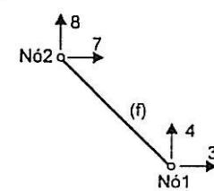

A structural member labeled (f) connects node N02 to node N01. At node N02, there are two force vectors: a vertical upward arrow labeled 8 and a horizontal rightward arrow labeled 7. At node N01, there are two force vectors: a vertical upward arrow labeled 4 and a horizontal rightward arrow labeled 3.

Engineering drawing: Free body diagram of a structural member with applied forces.

### 3.4.3. MONTE A MATRIZ DE RIGIDEZ DA ESTRUTURA A PARTIR DAS MATRIZES DE RIGIDEZ DOS SEUS ELEMENTOS - SISTEMA DE EQUAÇÕES DE EQUILÍBRIO

Utilizando o Procedimento de Montagem definido anteriormente, podemos obter a Matriz de Rigidez da Estrutura a partir das Matrizes de Rigidez de cada um dos seus elementos.

Devemos identificar em cada Matriz de Rigidez de Elemento, a sua contribuição nessa montagem. Por exemplo, os coeficientes I,J (linha, coluna) da matriz de um elemento serão adicionados na mesma localização I,J da Matriz da estrutura. Assim, por intermédio desse procedimento, serão obtidas as *Equações de Equilíbrio da Estrutura*. É obtida a Matriz Coeficiente que relaciona as Forças Nodais e os Deslocamentos Nodais para toda a Estrutura. A estrutura analisada tem 8 graus de liberdade, portanto a sua Matriz de Rigidez terá dimensão  $8 \times 8$ . A Matriz de Rigidez da Estrutura contém todos os seus graus de liberdade identificados no vetor de localização. Inserindo os termos nas linhas e colunas correspondentes para montar [K], teremos:

$$[K] = \frac{AE}{L}$$

| 1          | 2          | 3          | 4          | 5          | 6          | 7          | 8          |
|------------|------------|------------|------------|------------|------------|------------|------------|
| $1+0+0,36$ | $0+0+0,48$ | -1         | 0          | -0,36      | -0,48      | 0          | 0          |
| $0+0+0,48$ | $0+1+0,64$ | 0          | 0          | -0,48      | -0,64      | 0          | -1         |
| -1         | 0          | $1+0+0,36$ | $0+0-0,48$ | 0          | 0          | -0,36      | 0,48       |
| 0          | 0          | $0+0-0,48$ | $0+1+0,64$ | 0          | -1         | 0,48       | -0,64      |
| -0,36      | -0,48      | 0          | 0          | $0+1+0,36$ | $0+0+0,48$ | -1         | 0          |
| -0,48      | -0,64      | 0          | -1         | $0+0+0,48$ | $1+0+0,64$ | 0          | 0          |
| 0          | 0          | -0,36      | 0,48       | -1         | 0          | $1+0+0,36$ | $0+0-0,48$ |
| 0          | -1         | 0,48       | -0,64      | 0          | 0          | $0+0-0,48$ | $0+1+0,64$ |

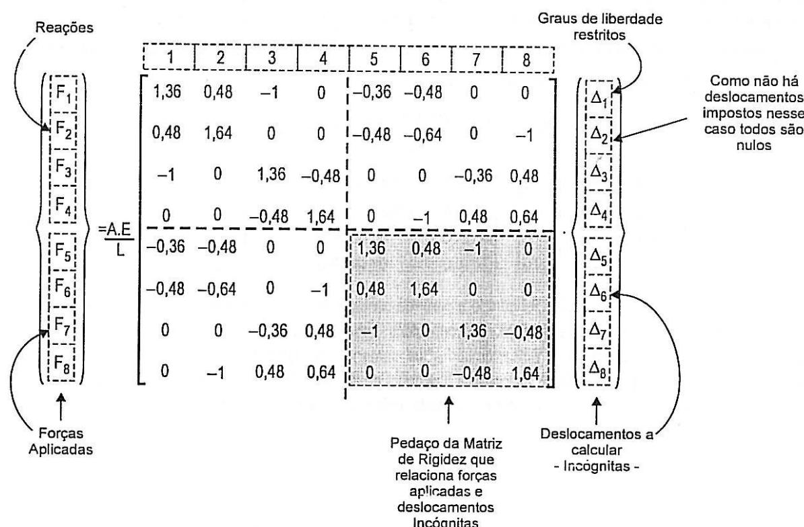

The diagram illustrates the partitioning of a stiffness matrix  $K$ . The matrix is 8x8, with rows 1-4 and columns 1-4 representing the "Graus de liberdade restritos" (constrained degrees of freedom), and rows 5-8 and columns 5-8 representing the "Deslocamentos a calcular - Incógnitas" (unknown displacements). The matrix is divided into four sub-matrices by dashed lines. The top-left sub-matrix (rows 1-4, columns 1-4) is labeled "Pedaço da Matriz de Rigidez que relaciona forças aplicadas e deslocamentos Incógnitas". The top-right sub-matrix (rows 1-4, columns 5-8) is labeled "Graus de liberdade restritos". The bottom-left sub-matrix (rows 5-8, columns 5-8) is shaded and labeled "Pedaço da Matriz de Rigidez que relaciona forças aplicadas e deslocamentos Incógnitas". The bottom-right sub-matrix (rows 5-8, columns 5-8) is labeled "Deslocamentos a calcular - Incógnitas". The left side shows the "Reações" (reactions)  $F_1$  to  $F_8$  and the "Forças Aplicadas" (applied forces)  $F_5$  to  $F_8$ . The right side shows the unknown displacements  $\Delta_1$  to  $\Delta_8$ . A note on the right states: "Como não há deslocamentos impostos nesse caso todos são nulos" (Since there are no imposed displacements in this case, all are zero).

Reações

Graus de liberdade restritos

Como não há deslocamentos impostos nesse caso todos são nulos

Forças Aplicadas

Pedaço da Matriz de Rigidez que relaciona forças aplicadas e deslocamentos Incógnitas

Deslocamentos a calcular - Incógnitas

|       | 1     | 2     | 3     | 4     | 5     | 6     | 7     | 8     |
|-------|-------|-------|-------|-------|-------|-------|-------|-------|
| $F_1$ | 1,36  | 0,48  | -1    | 0     | -0,36 | -0,48 | 0     | 0     |
| $F_2$ | 0,48  | 1,64  | 0     | 0     | -0,48 | -0,64 | 0     | -1    |
| $F_3$ | -1    | 0     | 1,36  | -0,48 | 0     | 0     | -0,36 | 0,48  |
| $F_4$ | 0     | 0     | -0,48 | 1,64  | 0     | -1    | 0,48  | 0,64  |
| $F_5$ | -0,36 | -0,48 | 0     | 0     | 1,36  | 0,48  | -1    | 0     |
| $F_6$ | -0,48 | -0,64 | 0     | -1    | 0,48  | 1,64  | 0     | 0     |
| $F_7$ | 0     | 0     | -0,36 | 0,48  | -1    | 0     | 1,36  | -0,48 |
| $F_8$ | 0     | -1    | 0,48  | 0,64  | 0     | 0     | -0,48 | 1,64  |

$= \frac{A.E}{L}$

Technical illustration: Stiffness matrix partitioning for structural analysis with applied forces and unknown displacements.

Esta última equação matricial representa as equações de Equilíbrio da Estrutura.

Se fizéssemos o produto matricial poderíamos representar as equações constituintes desse sistema. Na forma matricial essas equações poderiam ser resolvidas de forma compacta. A título de ilustração, representantes o sistema de equações:

|                  |                                                                                                                                                                                         |        |
|------------------|-----------------------------------------------------------------------------------------------------------------------------------------------------------------------------------------|--------|
| REAÇÕES          | $F_1 = (1,36 \cdot \Delta_1 + 0,48 \cdot \Delta_2 - 1 \cdot \Delta_3 + 0 \cdot \Delta_4 - 0,36 \cdot \Delta_5 - 0,48 \cdot \Delta_6 + 0 \cdot \Delta_7 + 0 \cdot \Delta_8) \cdot AE/L$  | (3.10) |
|                  | $F_2 = (0,48 \cdot \Delta_1 + 1,64 \cdot \Delta_2 + 0 \cdot \Delta_3 + 0 \cdot \Delta_4 - 0,48 \cdot \Delta_5 - 0,64 \cdot \Delta_6 + 0 \cdot \Delta_7 - 1 \cdot \Delta_8) \cdot AE/L$  |        |
|                  | $F_3 = (-1 \cdot \Delta_1 + 0 \cdot \Delta_2 - 1,36 \cdot \Delta_3 - 0,48 \cdot \Delta_4 + 0 \cdot \Delta_5 + 0 \cdot \Delta_6 - 0,36 \cdot \Delta_7 + 0,48 \cdot \Delta_8) \cdot AE/L$ |        |
|                  | $F_4 = (0 \cdot \Delta_1 + 0 \cdot \Delta_2 - 0,48 \cdot \Delta_3 + 1,64 \cdot \Delta_4 + 0 \cdot \Delta_5 - 1 \cdot \Delta_6 + 0,48 \cdot \Delta_7 - 0,64 \cdot \Delta_8) \cdot AE/L$  |        |
| FORÇAS APLICADAS | $F_5 = (-0,36 \cdot \Delta_1 - 0,48 \cdot \Delta_2 + 0 \cdot \Delta_3 + 0 \cdot \Delta_4 + 1,36 \cdot \Delta_5 + 0,48 \cdot \Delta_6 - 1 \cdot \Delta_7 + 0 \cdot \Delta_8) \cdot AE/L$ |        |
|                  | $F_6 = (-0,48 \cdot \Delta_1 - 0,64 \cdot \Delta_2 + 0 \cdot \Delta_3 - 1 \cdot \Delta_4 + 0,48 \cdot \Delta_5 + 1,64 \cdot \Delta_6 + 0 \cdot \Delta_7 + 0 \cdot \Delta_8) \cdot AE/L$ |        |
|                  | $F_7 = (0 \cdot \Delta_1 + 0 \cdot \Delta_2 - 0,36 \cdot \Delta_3 + 0,48 \cdot \Delta_4 - 1 \cdot \Delta_5 + 0 \cdot \Delta_6 + 1,36 \cdot \Delta_7 - 0,48 \cdot \Delta_8) \cdot AE/L$  |        |
|                  | $F_8 = (0 \cdot \Delta_1 - 1 \cdot \Delta_2 + 0,48 \cdot \Delta_3 - 0,64 \cdot \Delta_4 + 0 \cdot \Delta_5 + 0 \cdot \Delta_6 - 0,48 \cdot \Delta_7 + 1,64 \cdot \Delta_8) \cdot AE/L$  |        |

### 3.4.4. DEFINA AS CONDIÇÕES DE CONTORNO DE DESLOCAMENTOS-AS RESTRIÇÕES- PARA PREPARAR A SOLUÇÃO DO SISTEMA DE EQUAÇÕES

A Matriz de Rigidez da Estrutura completamente montada é **Simétrica e Singular**. Já sabemos da impossibilidade de resolver esse sistema devido ao movimento de corpo rígido, pois o sistema completo representa a estrutura sem qualquer vínculo. Para as **condições de Restrição**, isto é, a estrutura restrita em A e B, correspondente aos **graus de liberdade 1,2,3 e 4**, as Forças Externas “aplicadas” na estrutura são  $F_1, F_2$  e  $F_3$  e  $F_4$ . Essas forças externas não são aplicadas, mas sim **Reações de Apoio** e são incógnitas do Problema. Dessa forma, como vimos anteriormente, podemos estabelecer a relação entre as forças nodais aplicadas e os correspondentes deslocamentos nodais. Assim, a relação entre as forças  $F_5, F_6, F_7$  e  $F_8$ , e os correspondentes deslocamentos  $\Delta_5, \Delta_6, \Delta_7$  e  $\Delta_8$  é expressa pelos coeficientes representados nas **localizações 5,6,7 e 8 da matriz de Rigidez**. Portanto, uma parte da Matriz de Rigidez é invertida para obter os deslocamentos nodais.

Assim com  $F_5 = +2P = 1000\text{kgf}$ ;  $F_6 = +P = 500\text{kgf}$  e  $\frac{AE}{L} = \frac{300 \cdot 21000}{1000} = 6300$  temos:

$$\begin{Bmatrix} F_5 \\ F_6 \\ F_7 \\ F_8 \end{Bmatrix} = \begin{Bmatrix} 2P \\ P \\ 0 \\ 0 \end{Bmatrix} = \begin{Bmatrix} 1000 \\ 500 \\ 0 \\ 0 \end{Bmatrix} = \begin{bmatrix} 8568 & 3024 & -6300 & 0 \\ 3024 & 10332 & 0 & 0 \\ -6300 & 0 & 8568 & -3024 \\ 0 & 0 & -3024 & 10332 \end{bmatrix} \begin{Bmatrix} \Delta_5 \\ \Delta_6 \\ \Delta_7 \\ \Delta_8 \end{Bmatrix}$$
 (3.11)

Deve-se observar que este sistema de equações foi gerado a partir da condição de que os **componentes de deslocamento nos apoios fixos são nulos**. No caso geral, estes valores conhecidos poderiam ser não nulos, e a relação entre forças e deslocamentos incluiria estes termos. Deve-se notar também, que somente são aplicadas Forças associadas aos graus de liberdade 5 e 6. Porém, os componentes de força associados aos graus de liberdade 7 e 8 estão representados na Matriz coluna das cargas, e seus valores são iguais a zero. O **Quadro IV** aproveita a idéia deste exercício e introduz a Generalização válida para todos os casos de modelos em elementos finitos.

#### QUADRO IV – GENERALIZANDO O PROCEDIMENTO PARA O CÁLCULO DOS DESLOCAMENTOS PARA QUALQUER TIPO DE MODELO ESTRUTURAL

Para uma montagem de Elementos Finitos, podemos identificar no caso mais geral:

![Diagrama explicando a equação de deslocamento. A equação é: {Fj} / {Fj} = [K1,1 | K1,2; K2,1 | K2,2] * [I | II] * {Delta1} / {Delta2}. As caixas 'Reações' e 'Forças Aplicadas' apontam para os vetores {Fj} e {Fj}. A caixa 'Deslocamentos impostos conhecidos. Em particular para apoios fixos esses componentes são nulos' aponta para o vetor {Delta1}. A caixa 'Componentes de deslocamentos a determinar' aponta para o vetor {Delta2}. A matriz de rigidez é dividida em duas partes: I e II.](91be14371a97fb5ce9eeb29ae18d07c3_img.jpg)

$$\begin{Bmatrix} F_j \\ F_j \end{Bmatrix} = \begin{bmatrix} K_{I,1} & K_{I,2} \\ K_{II,1} & K_{II,2} \end{bmatrix} \begin{bmatrix} I \\ II \end{bmatrix} \cdot \begin{Bmatrix} \Delta_1 \\ \Delta_2 \end{Bmatrix}$$

Reações

Forças Aplicadas

Deslocamentos impostos conhecidos. Em particular para apoios fixos esses componentes são nulos

Componentes de deslocamentos a determinar

Diagrama explicando a equação de deslocamento. A equação é: {Fj} / {Fj} = [K1,1 | K1,2; K2,1 | K2,2] \* [I | II] \* {Delta1} / {Delta2}. As caixas 'Reações' e 'Forças Aplicadas' apontam para os vetores {Fj} e {Fj}. A caixa 'Deslocamentos impostos conhecidos. Em particular para apoios fixos esses componentes são nulos' aponta para o vetor {Delta1}. A caixa 'Componentes de deslocamentos a determinar' aponta para o vetor {Delta2}. A matriz de rigidez é dividida em duas partes: I e II.

As "MACROS" Matrizes podem ser multiplicadas, resultando:

$$\{F_I\} = [K_{I, I}] \cdot \{\Delta_I\} + [K_{I, II}] \cdot \{\Delta_{II}\} \quad (1)$$

$$\{F_{II}\} = [K_{II, I}] \cdot \{\Delta_I\} + [K_{II, II}] \cdot \{\Delta_{II}\} \quad (2)$$

Resolve-se o Sistema ou Equação Matricial (2), pois  $\{F_{II}\}$ ,  $[K_{II, I}]$  e  $[K_{II, II}]$  são conhecidas e determina-se  $\{\Delta_{II}\}$

Retorna-se à equação (1) e com  $\{\Delta_{II}\}$ , determina-se  $\{F_I\}$

Em particular, para apoios fixos tem-se  $\{\Delta_I\} = \{0\} = \text{ZERO}$ , então

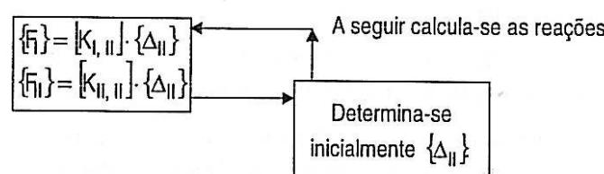

A seguir calcula-se as reações

```
graph LR; A["{f_I} = [K_I, II] · {Δ_II} <br/>{f_II} = [K_II, II] · {Δ_II}"] --> B["Determina-se inicialmente {Δ_II}"]; B --> A;
```

The diagram shows a flowchart with two main components. On the left, a box contains the equations  $\{f_I\} = [K_{I, II}] \cdot \{\Delta_{II}\}$  and  $\{f_{II}\} = [K_{II, II}] \cdot \{\Delta_{II}\}$ . On the right, a box contains the text "Determina-se inicialmente  $\{\Delta_{II}\}$ ". An arrow points from the right box to the left box, and another arrow points from the left box to the right box. Above the right box, the text "A seguir calcula-se as reações" is written.

Flowchart: Flowchart showing calculation of initial delta values and reaction calculation.

### 3.4.5. DETERMINE OS DESLOCAMENTOS NODAIS PARA A ESTRUTURA INTEIRA, RESOLVENDO O SISTEMA DE EQUAÇÕES, E POSTERIORMENTE, AS REAÇÕES DE APOIO

A equação 3.11 permite efetuar o Cálculo dos Deslocamentos para a Estrutura inteira, por intermédio da Inversão de parte da Matriz de Rigidez da Estrutura, como já discutido no Exercício do Elemento de mola do capítulo anterior. Naquela oportunidade o Cálculo da Matriz Inversa foi efetuado por Procedimento Formal, adequado para Cálculo Manual de Matrizes de pequena ordem, tal como 2x2 ou 3x3. Para Matrizes de maior ordem, como aquelas encontradas em grandes sistemas de equações lineares simultâneas utilizadas nas Aplicações do Método dos Elementos Finitos, e que constituem importante tarefa das Análise Numéricas, outros procedimentos diferentes daquele acima apresentado são utilizados. Um dos métodos mais conhecidos de solução de sistemas de equações lineares, é o **Método de Gauss, da Eliminação**. O **Método Básico de Gauss reduz as equações à forma triangular**. Para introduzir essa idéia, utilizaremos o Método de Gauss nas operações manuais de resolução do Sistema deste exercício, com apenas pretensões didáticas (ver Quadro V). A implementação de rotinas para grandes sistemas de equações, e que fogem aos objetivos deste texto, deveriam ser aprofundadas pelo leitor que pretende se envolver com a implantação dessas rotinas em computador, como por exemplo, nos trabalhos de desenvolvimento de "softwares" de análise.

O **Método de Gauss ou Método das Eliminações Sucessivas**, é um processo para resolução de Sistemas Lineares, que por intermédio de Transformações Elementares, **torna o Sistema dado em outro equivalente e de solução imediata**. Tais operações são basicamente:

- i) **Permutar entre si duas equações do Sistema.** Isso permite, em termos práticos, agrupar as equações de forma organizada. Por exemplo, para as equações do Quadro IV, os termos correspondentes às Reações de Apoio ( $F_i$ ), ficariam agrupadas na parte “superior” da Matriz de Carga, e assim sucessivamente para os outros elementos do sistema, sem alterar o Sistema.
- ii) Multiplicar todos os termos de uma das equações do Sistema por um número diferente de zero
- iii) **Multiplicar uma equação do Sistema por um número diferente de zero, e adicionar o resultado a outra equação do Sistema.**

Esses procedimentos têm o seguinte objetivo:

- *Eliminar a 1<sup>a</sup> incógnita das equações, com exceção da primeira equação. Isso pode ser feito tornando seu coeficiente igual a zero.*
- *Eliminar a 2<sup>a</sup> incógnita das equações, com exceção da segunda equação. Isso pode ser feito tornando seu coeficiente igual a zero.*
- *Eliminar a 3<sup>a</sup> incógnita das equações, com exceção da terceira equação. Isso pode ser feito tornando seu coeficiente igual a zero, e assim sucessivamente.*

Por esse procedimento vai-se **reduzindo o número de incógnitas das equações seguintes sucessivamente**, até que na última equação teremos somente uma equação a uma incógnita- **“Forward Reduction”**

A partir desta última equação reduzida, determina-se a última incógnita, e voltando na equação anterior e substituindo-se essa última incógnita, determina-se a penúltima, e assim sucessivamente. **“Backsubstitution”**.

Esse procedimento é aplicado ao exemplo do presente exercício como ilustração.

Aplicando esse procedimento ao sistema de equações deste exercício, teremos:

$$\begin{cases} 8568 \cdot \Delta_5 + 3024 \cdot \Delta_6 - 6300 \cdot \Delta_7 + 0 \cdot \Delta_8 = 1000 & (1) \end{cases}$$

$$3024 \cdot \Delta_5 + 10332 \cdot \Delta_6 + 0 \cdot \Delta_7 + 0 \cdot \Delta_8 = 500 \quad (2)$$

$$-6300 \cdot \Delta_5 + 0 \cdot \Delta_6 + 8568 \cdot \Delta_7 - 3024 \cdot \Delta_8 = 0 \quad (3)$$

$$0 \cdot \Delta_5 + 0 \cdot \Delta_6 - 3024 \cdot \Delta_7 + 10332 \cdot \Delta_8 \quad (4)$$

**Passo 1:** Subtrair um múltiplo da equação (1), das equações (2) e (3) para obter zeros na primeira coluna de [K]. Isto significa que

$\left( -\frac{3024}{8568} \right)$  a primeira linha é adicionada à Segunda linha, e que  $\left( \frac{6300}{8568} \right)$  vezes a primeira linha é adicionado à terceira linha.

$$\begin{cases} 8568 \cdot \Delta_5 + 3024 \cdot \Delta_6 - 6300 \cdot \Delta_7 + 0 \cdot \Delta_8 = 1000 & (1') \end{cases}$$

$$0 \cdot \Delta_5 + 9264,7 \cdot \Delta_6 + 2223,5 \cdot \Delta_7 + 0 \cdot \Delta_8 = 147,1 \quad (2')$$

$$0 \cdot \Delta_5 + 2223,5 \cdot \Delta_6 + 3935,6 \cdot \Delta_7 - 3024 \cdot \Delta_8 = 735,3 \quad (3')$$

$$0 \cdot \Delta_5 + 0 \cdot \Delta_6 - 3024 \cdot \Delta_7 + 10332 \cdot \Delta_8 = 0 \quad (4')$$

**Passo 2:**  $\left(-\frac{2223,5}{9264,7}\right)$  vezes a equação (2') é adicionado à equação (3').

$$\begin{cases} 8568 \cdot \Delta_5 + 3024 \cdot \Delta_6 - 6300 \cdot \Delta_7 + 0 \cdot \Delta_8 = 1000 & (1'') \\ 0 \cdot \Delta_5 + 9264,7 \cdot \Delta_6 + 2223,5 \cdot \Delta_7 + 0 \cdot \Delta_8 = 147,1 & (2'') \\ 0 \cdot \Delta_5 + 0 \cdot \Delta_6 + 3402 \cdot \Delta_7 - 3024 \cdot \Delta_8 = 700 & (3'') \\ 0 \cdot \Delta_5 + 0 \cdot \Delta_6 - 3024 \cdot \Delta_7 + 10332 \cdot \Delta_8 = 0 & (4'') \end{cases}$$

**Passo 3:**  $\left(\frac{3024}{3402}\right)$  vezes a equação (3'') é adicionado à equação (4'').

$$\begin{cases} 8568 \cdot \Delta_5 + 3024 \cdot \Delta_6 - 6300 \cdot \Delta_7 + 0 \cdot \Delta_8 = 1000 & (1''') \\ 0 \cdot \Delta_5 + 9264,7 \cdot \Delta_6 + 2223,5 \cdot \Delta_7 + 0 \cdot \Delta_8 = 147,1 & (2''') \\ 0 \cdot \Delta_5 + 0 \cdot \Delta_6 + 3402 \cdot \Delta_7 - 3024 \cdot \Delta_8 = 700 & (3''') \\ 0 \cdot \Delta_5 + 0 \cdot \Delta_6 + 0 \cdot \Delta_7 + 7644 \cdot \Delta_8 = 622,2 & (4''') \end{cases}$$

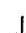

Começar resolvendo (4''')  $\rightarrow$  em seguida substituir nas equações anteriores. Assim:

$$(4''') \Delta_8 = \frac{622,2}{7644} \rightarrow \boxed{\Delta_8 \approx 0,08140 \text{ mm}}$$

$$(3''') 3402 \cdot \Delta_7 - 3024 \times 0,08140 = 700 \rightarrow \boxed{\Delta_7 \approx 0,27812 \text{ mm}}$$

$$(2''') 9264,7 \cdot \Delta_6 + 2223,5 \cdot 0,27812 = 147,1 \rightarrow \boxed{\Delta_6 \approx -0,05087 \text{ mm}}$$

$$(1''') 8568 \cdot \Delta_5 + 3024 \cdot (-0,05087) - 6300 \cdot (0,27812) = 1000 \rightarrow \boxed{\Delta_5 \approx 0,33917 \text{ mm}}$$

Dessa forma, estão determinados os componentes de deslocamentos para toda a estrutura.

As equações (3.10) permitirão o Cálculo das Reações de Apoio na Estrutura.

Assim com  $\Delta_1 = \Delta_2 = \Delta_3 = \Delta_4 = 0$ , e substituindo os valores dos deslocamentos anteriormente calculados, teremos os valores das Forças de Reação, com os respectivos sinais, que devem ser interpretados de acordo com a Convenção de sinais, referida aos eixos globais.

$$F_1 = -615,41 \text{ Kgf} - \text{Em sentido contrário ao eixo X.}$$

$$F_2 = -1333,36 \text{ Kgf} - \text{Em sentido contrário ao eixo Y.}$$

$$F_3 = -384,62 \text{ Kgf} - \text{Em sentido Contrário ao eixo X.}$$

$$F_4 = 833,31 \text{ Kgf} - \text{No mesmo sentido do eixo Y.}$$

Note que as Forças Externas aplicadas na estrutura e as reações de apoio estão em equilíbrio, como é representado na figura 3.10.

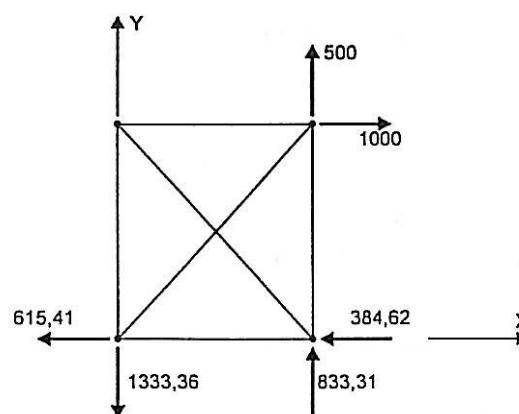

A square is plotted on a Cartesian coordinate system with the Y-axis pointing upwards and the X-axis pointing to the right. The square has vertices at (0, 0), (0, 615,41), (1333,36, 0), and (1000, 500). The diagonals connect opposite vertices. The following values are indicated with arrows:

- 615,41: points to the left from the bottom-left vertex.
- 1333,36: points downwards from the bottom-left vertex.
- 500: points upwards from the top-right vertex.
- 1000: points to the right from the top-right vertex.
- 384,62: points to the right from the bottom-right vertex.
- 833,31: points upwards from the bottom-right vertex.

X

Technical illustration: Square with diagonal lines and coordinate axes showing numerical values.

Figura 3.10 – Forças Aplicadas e Reações de Apoio para Estrutura em Equilíbrio.

### 3.4.6. DETERMINE AS FORÇAS INTERNAS EM CADA ELEMENTO A PARTIR DO CONHECIMENTO DOS DESLOCAMENTOS NODAIS ASSOCIADOS AO ELEMENTO

Após obter o Campo de Deslocamentos para a Estrutura inteira, podemos identificar para cada elemento isolado, quais são os componentes de deslocamentos nodais associados ao elemento, isto é, em cada um dos graus de liberdade. Dessa forma poderá ser definida a configuração deformada do mesmo. Esse procedimento é efetuado elemento por elemento, pois conhecemos a Lei que exprime a Força Interna no mesmo em função dos deslocamentos nodais. Essa idéia, como vimos no exemplo da mola, é geral para todas as montagens de elementos finitos. A deformação obtida nos diversos elementos de uma estrutura, decorre do campo de deslocamentos a que esta está submetida. No caso da barra de treliça, à semelhança da Mola, a condição de deformação é obtida pela diferença dos deslocamentos dos Nós que definem o elemento. Deve-se notar que a Lei de Deformação Interna do Elemento foi formulada no Sistema Local de Coordenadas, e no Quadro III vimos que  $\text{Força Interna} = \frac{E.A}{L} \cdot d$ , onde  $d$  representa a diferença dos deslocamentos  $u_1$  e  $u_2$ .

A expressão da Deformação é sempre definida no Sistema Local, até porque quando o elemento finito é formulado, não se conhece antecipadamente qual será a sua posição em uma montagem qualquer. Como a Estrutura completa foi resolvida no Sistema Global, devemos transformar esses valores calculados exprimindo-os agora no Sistema Local. Assim:

$$\mathcal{F}_e = \frac{A.E}{L} \cdot (u_2 - u_1) = \text{Força Interna em Elemento de barra qualquer- Sistema Local}$$

A figura 3.11 representa para um Elemento qualquer de barra, os componentes de deslocamentos nos Sistema Local e Global. Utilizando a identificação dos nós 1 e 2 do elemento, podemos representar os componentes de deslocamento no sistema global. Representaremos genericamente por  $U$  e  $V$  os deslocamentos em  $X$  e  $Y$ , e depois faremos a correspondência com a numeração dos graus de liberdade da estrutura inteira. Da equação (3.7), temos:

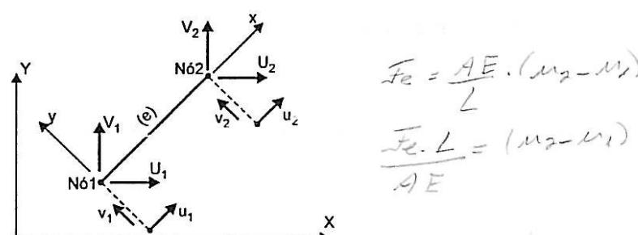

The diagram shows a two-node line element (e) with nodes N01 and N02. Node N01 has local coordinate axes  $v_1$  and  $u_1$ , and global axes  $Y$  and  $X$ . Node N02 has local coordinate axes  $v_2$  and  $u_2$ , and global axes  $X$  and  $Y$ . The element length is  $L$ .

$$\bar{F}_e = \frac{AE}{L} \cdot (u_2 - u_1)$$
$$\frac{\bar{F}_e \cdot L}{AE} = (u_2 - u_1)$$

Engineering drawing: Finite element analysis of a two-node line element with coordinate systems and formulas.

Figura 3.11 – Para cálculo da força Interna na Barra, os deslocamentos  $U_1$ ,  $V_1$ ,  $U_2$ ,  $V_2$  globais devem ser transformados para o sistema local, para calcular  $\mathcal{F}_e = \frac{AE}{L} \cdot (u_2 - u_1)$ .

$$\{\delta\} = [T] \cdot \{\Delta\} \rightarrow \begin{Bmatrix} u_1 \\ v_1 \\ u_2 \\ v_2 \end{Bmatrix} = \begin{bmatrix} \lambda & \mu & 0 & 0 \\ -\mu & \lambda & 0 & 0 \\ 0 & 0 & \lambda & \mu \\ 0 & 0 & -\mu & \lambda \end{bmatrix} \cdot \begin{Bmatrix} U_1 \\ V_1 \\ U_2 \\ V_2 \end{Bmatrix} \rightarrow$$

Queremos calcular  $u_1$  e  $u_2$ , portanto:

$$u_1 = \lambda \cdot U_1 + \mu \cdot V_1$$

$$u_2 = \lambda \cdot U_2 + \mu \cdot V_2$$

Fazendo  $u_2 - u_1 = \lambda \cdot U_2 + \mu \cdot V_2 - \lambda \cdot U_1 - \mu \cdot V_1 = \lambda(U_2 - U_1) + \mu \cdot (V_2 - V_1)$  representado na forma matricial:

$$\{u_2 - u_1\} = [\lambda \mu]_e \cdot \begin{Bmatrix} U_2 - U_1 \\ V_2 - V_1 \end{Bmatrix} \rightarrow \frac{F_e \cdot L}{AE} = [\lambda \mu]_e \cdot \begin{Bmatrix} U_2 - U_1 \\ V_2 - V_1 \end{Bmatrix}$$

Assim:

$$\mathcal{F}_e = \left( \frac{AE}{L} \right)_e [\lambda \mu]_e \cdot \begin{Bmatrix} U_2 - U_1 \\ V_2 - V_1 \end{Bmatrix} \quad F_e = \frac{AE}{L} \dots \quad (3.12)$$

Como a expressão é calculada elemento por elemento, para cada **elemento e**, temos a sua área de seção e o material correspondente. Assim cada elemento pode ter geometria e material diferentes do outro.

Definimos a sua posição de cada elemento na montagem por intermédio do seno e cosseno do ângulo  $\alpha$  e identificamos os Deslocamentos Globais associados a ele.

Assim, com a expressão 3.12 podemos calcular as Forças Internas em todos os elementos do Modelo da Estrutura. Como essa expressão relaciona os deslocamentos globais aos nós 1 e 2, deve-se apenas identificar na numeração geral dos graus de liberdade da estrutura quais são esses componentes. A figura 3.12 identifica essa correspondência e organiza essa relação em forma de tabela.

Na montagem da matriz de rigidez da Estrutura, foram consideradas inicialmente as Matrizes de Rigidez de cada Elemento. Para cada elemento, foram contabilizadas as características geométricas e as propriedades do material associado ao elemento. Desta forma, em principio cada elemento poderia ser constituído de um material diferente.

Esta é uma característica geral dos modelos em elementos finitos. Após a resolução do sistema de equações para a estrutura inteira, o cálculo das forças internas em cada elemento considera as características de cada elemento separadamente em termos de propriedades geométricas e de material.

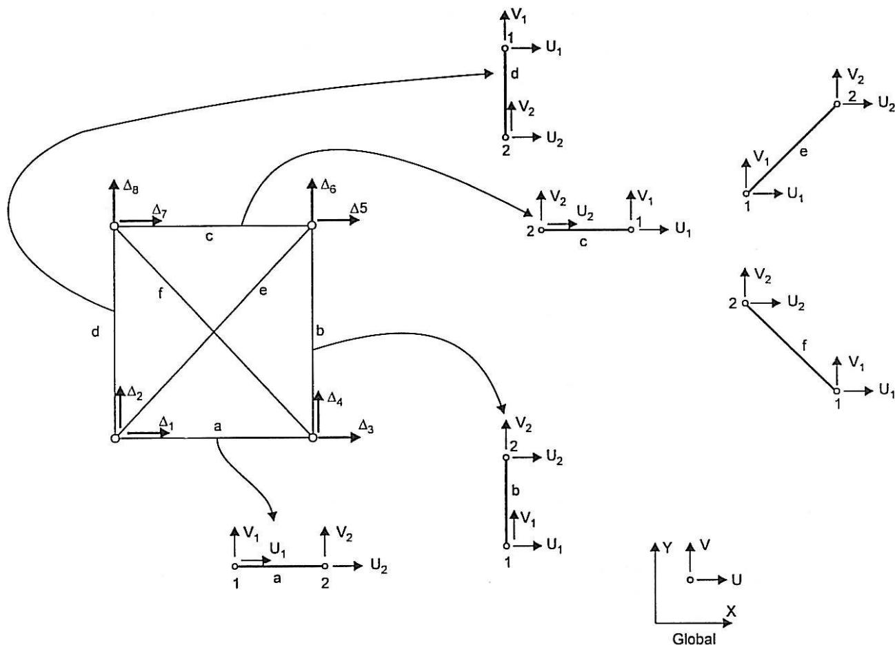

The diagram illustrates a structural frame with a global coordinate system (X, Y) and a local coordinate system (U, V) for each member. The frame consists of a square with diagonal members, labeled with nodes 1, 2, 3, 4 and members a, b, c, d, e, f. Displacements  $\Delta_1$  through  $\Delta_8$  are indicated at the nodes. Each member is shown with its local coordinate system (U, V) and displacement components ( $U_1, U_2, V_1, V_2$ ). Arrows connect the global frame to the individual member coordinate systems.

Global Coordinate System: X, Y

Local Coordinate System: U, V

Members and Displacements:

- Member a: Nodes 1, 2. Displacements:  $\Delta_1$  (node 1),  $\Delta_3$  (node 2). Local:  $U_1$ ,  $U_2$ .
- Member b: Nodes 2, 3. Displacements:  $\Delta_2$  (node 2),  $\Delta_4$  (node 3). Local:  $V_1$ ,  $V_2$ .
- Member c: Nodes 3, 4. Displacements:  $\Delta_5$  (node 4). Local:  $U_1$ ,  $U_2$ .
- Member d: Nodes 4, 1. Displacements:  $\Delta_6$  (node 4),  $\Delta_8$  (node 1). Local:  $V_1$ ,  $V_2$ .
- Member e: Nodes 1, 2. Displacements:  $\Delta_7$  (node 1),  $\Delta_8$  (node 2). Local:  $U_1$ ,  $U_2$ .
- Member f: Nodes 2, 3. Displacements:  $\Delta_3$  (node 3). Local:  $V_1$ ,  $V_2$ .

Local Coordinate Systems:

- Member a:  $U_1$  (horizontal),  $U_2$  (vertical).
- Member b:  $V_1$  (horizontal),  $V_2$  (vertical).
- Member c:  $U_1$  (horizontal),  $U_2$  (vertical).
- Member d:  $V_1$  (horizontal),  $V_2$  (vertical).
- Member e:  $U_1$  (horizontal),  $U_2$  (vertical).
- Member f:  $V_1$  (horizontal),  $V_2$  (vertical).

Engineering drawing: Structural frame analysis showing global and local coordinate systems and displacement components.

| Elemento | Deslocamentos |               | Globais       |               |
|----------|---------------|---------------|---------------|---------------|
|          | U<sub>1</sub> | V<sub>1</sub> | U<sub>2</sub> | V<sub>2</sub> |
| (a)      | Δ<sub>1</sub> | Δ<sub>2</sub> | Δ<sub>3</sub> | Δ<sub>4</sub> |
| (b)      | Δ<sub>3</sub> | Δ<sub>4</sub> | Δ<sub>5</sub> | Δ<sub>6</sub> |
| (c)      | Δ<sub>5</sub> | Δ<sub>6</sub> | Δ<sub>7</sub> | Δ<sub>8</sub> |
| (d)      | Δ<sub>7</sub> | Δ<sub>8</sub> | Δ<sub>1</sub> | Δ<sub>2</sub> |
| (e)      | Δ<sub>1</sub> | Δ<sub>2</sub> | Δ<sub>5</sub> | Δ<sub>6</sub> |
| (f)      | Δ<sub>3</sub> | Δ<sub>4</sub> | Δ<sub>7</sub> | Δ<sub>8</sub> |

Figura 3.12 – Correspondência entre os Deslocamentos Globais U, V e Δ.

Por exemplo, para a barra (b) teríamos:

$$\mathcal{T}_b = \left( \frac{AE}{L} \right)_b [\lambda \mu]_b \cdot \left\{ \frac{U_2 - U_1}{V_2 - V_1} \right\} = \left( \frac{0,8 \cdot A \times E}{0,8 \cdot L} \right) \cdot [0 \quad 1] \cdot \left\{ \frac{\Delta_5 - \Delta_3}{\Delta_6 - \Delta_4} \right\}$$

$$\mathcal{T}_b = 6300 \cdot [0 \quad 1] \cdot \left\{ \frac{0,33917 - 0}{-0,05087 - 0} \right\}$$

$$\mathcal{T}_b = -320,5 \text{ kgf}$$

O sinal negativo da Força Interna indica que esta é de Compressão na barra.

Utilizando o Quadro III poderíamos calcular:  $\sigma = \frac{\mathcal{T}_b}{A} = -\frac{320,5 \text{ kgf}}{0,8 \cdot 300} = -1,34 \text{ kgf/mm}^2$  Tensão Normal de Compressão na Barra.

Utilizando a correspondência estabelecida entre U, V e  $\Delta$  para os diversos graus de liberdade podemos calcular as Forças Internas para os demais elementos de forma análoga:

$$\mathcal{F}_a = 6.300 \cdot [1 \ 0] \cdot \left\{ \frac{\Delta_3 - \Delta_1}{\Delta_4 - \Delta_2} \right\} = 6300 \cdot [1 \ 0] \cdot \left\{ \frac{0}{0} \right\} = 0 \Rightarrow \mathcal{F}_a = 0$$

$$\mathcal{F}_c = 6.300 \cdot [-1 \ 0] \cdot \left\{ \frac{\Delta_7 - \Delta_5}{\Delta_8 - \Delta_6} \right\} = 6300 \cdot [-1 \ 0] \cdot \left\{ \frac{0,27812 - 0,33917}{0,08140 - (-0,05087)} \right\} = 0 \Rightarrow \mathcal{F}_c = +384,62 \text{ kgf} \quad (\text{Tração})$$

$$\mathcal{F}_d = 6.300 \cdot [0 \ -1] \cdot \left\{ \frac{\Delta_1 - \Delta_7}{\Delta_2 - \Delta_8} \right\} = 6300 \cdot [0 \ -1] \cdot \left\{ \frac{0 - 0,27812}{0 - 0,08140} \right\} \Rightarrow \mathcal{F}_d = +512,82 \text{ kgf} \quad (\text{Tração})$$

$$\mathcal{F}_e = 6.300 \cdot [0,6 \ 0,8] \cdot \left\{ \frac{\Delta_5 - \Delta_1}{\Delta_6 - \Delta_2} \right\} = 6300 \cdot [0,6 \ 0,8] \cdot \left\{ \frac{0,33917 - 0}{-0,05087 - 0} \right\} \Rightarrow \mathcal{F}_e = +1025,68 \text{ kgf} \quad (\text{Tração})$$

$$\mathcal{F}_e = 6.300 \cdot [-0,6 \ 0,8] \cdot \left\{ \frac{\Delta_7 - \Delta_3}{\Delta_8 - \Delta_4} \right\} = 6300 \cdot [-0,6 \ 0,8] \cdot \left\{ \frac{0,27812 - 0}{0,08140 - 0} \right\} \Rightarrow \mathcal{F}_f = -641,04 \text{ kgf} \quad (\text{Compressão})$$

## 3.5. ASPECTOS GERAIS IMPORTANTES NA FORMULAÇÃO DE QUALQUER ELEMENTO FINITO

O Elemento de Treliça foi utilizado como “*pano de fundo*” para se introduzir o conceito de transformação entre sistemas de coordenas. Ao representarmos o equilíbrio de um elemento finito por intermédio do seu diagrama de corpo livre, as forças que justificam o equilíbrio do elemento podem estar referidas tanto ao sistema local como ao sistema global de coordenadas. O interesse de uma ou outra representação já foi discutido anteriormente. É importante, porém, observar que as transformações da representação do equilíbrio de forças de um sistema para outro é possível por intermédio da Matriz de Transformação. Esse conceito geral é válido para todos os elementos finitos. A particularidade associada a cada tipo de elemento, está no número de componentes de força que justificam o equilíbrio do elemento, e natureza dessas forças. Alguns elementos transferem apenas forças nodais, por exemplo o Elemento de Treliça, outros, como por exemplo o Elemento de Viga que estudaremos a seguir, transferem forças e momentos. Mas sempre será possível representar esses componentes em um sistema ou outro. Assim, todo elemento finito terá a sua matriz de transformação, e de forma análoga à treliça, a sua dimensão está associada ao número de componentes de força considerados no elemento. Da mesma forma, o elemento admitirá a representação da sua rigidez, por intermédio da sua Matriz de Rigidez, tanto no sistema local como no sistema global. A equação (3.8) que representa a transformação da Matriz de Rigidez de um Elemento do Sistema Local para o Sistema Global é de aplicação geral para todos os elementos finitos, desde que para cada Matriz de Rigidez do Elemento considerada no Sistema Local  $[k]^e$ , seja utilizada a Matriz de Transformação associada ao Elemento. A figura 3.13 ilustra essa idéia geral. Os exemplos representados do elemento de viga no espaço, elemento sólido na forma de um paralelepípedo e o elemento de casca serão estudados e formulados adiante, e foram colocados aqui apenas no sentido de enfatizar a idéia da Transformação da Matriz de Rigidez do Sistema Local para o Sistema Global no caráter mais amplo possível.